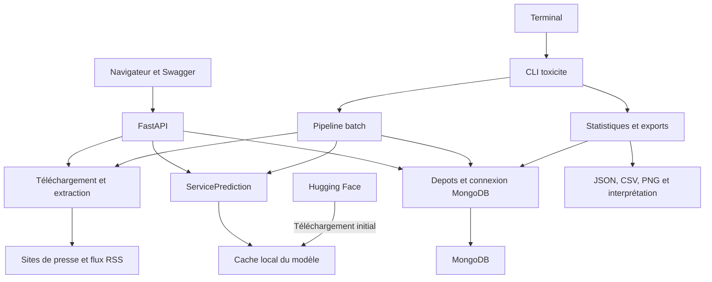
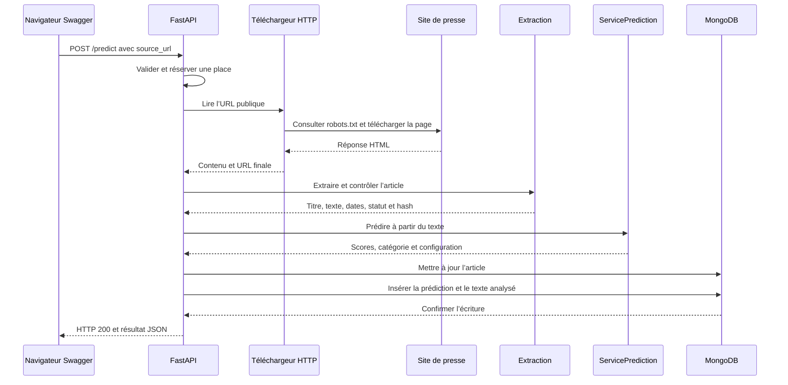

# Conception du système, architecture et logique métier

Ce document décrit l’implémentation du projet `analyse-toxicite`, version 0.1.0. Il présente les composants, le traitement des données, les règles de décision et le rôle des fichiers. Les commandes d’installation et d’exploitation figurent dans le README.

## Objectif fonctionnel

L’application collecte des articles de presse, extrait leur texte et calcule un score de toxicité avec le modèle multilingue `unitary/multilingual-toxic-xlm-roberta`. MongoDB conserve les contenus, les résultats et les informations nécessaires pour retrouver les conditions d’une analyse.

Deux interfaces donnent accès au traitement.

| Interface | Utilisation | Résultat |
| --- | --- | --- |
| API FastAPI | Soumettre un texte ou l’URL d’un article dans Swagger | Prédiction enregistrée et réponse JSON |
| CLI `toxicite` | Collecter plusieurs sources, analyser un run et produire un rapport | Historique de collecte, prédictions et statistiques par site |

La configuration batch contient huit sources, L’Humanité, GameSpot, Marianne, Le Monde, France 24, France 3 régions, Mediacités et Le Point. Le mode API par URL accepte également d’autres domaines publics.

## Architecture générale

L’application Python regroupe les interfaces, l’orchestration, la collecte, l’inférence et le stockage dans des modules distincts. L’API et le batch partagent le code de téléchargement, d’extraction, de prédiction et de persistance.



Les flèches représentent les appels entre composants. `ServicePrediction` est une classe Python utilisée par chaque processus qui effectue une inférence. Le processus API charge son instance au démarrage. La commande batch `analyser` charge sa propre instance pour traiter les articles du run.

Les classes `Depots` et `Telechargeur` concentrent les accès externes. Les interfaces les utilisent pour appliquer les mêmes règles de stockage et de téléchargement. Les paramètres proviennent des variables d’environnement et de `.env`, validés par Pydantic Settings.

## Parcours d’une demande API

### Initialisation du serveur

La commande `toxicite servir` vérifie que le port est disponible, puis démarre Uvicorn avec un worker. Le cycle de vie FastAPI établit la connexion MongoDB, crée les index, charge le modèle et prépare le téléchargeur HTTP. Une erreur d’initialisation interrompt le démarrage et apparaît dans les journaux.

| Route | Vérification ou action |
| --- | --- |
| `GET /health` | Confirme que le processus HTTP répond |
| `GET /ready` | Vérifie le modèle chargé et un ping MongoDB |
| `GET /docs` | Affiche Swagger et les exemples de requêtes |
| `POST /predict` | Valide la demande, calcule et enregistre une prédiction |

### Sélection du mode

| Corps de la demande | Traitement |
| --- | --- |
| `{"text": "Un texte à analyser"}` | Analyse le texte fourni |
| `{"source_url": "https://exemple.fr/article"}` | Télécharge l’article et analyse son texte extrait |
| `text` et `source_url` ensemble | Analyse `text` et conserve l’URL comme métadonnée |
| `text: null` avec `source_url` | Active l’extraction par URL |

Le schéma exige un texte ou une URL. Un texte vide ou composé uniquement d’espaces est refusé. Le mode URL est déclenché lorsque `text` est absent ou vaut `null`.

### Analyse automatique par URL



Le serveur effectue le téléchargement. Il contrôle les destinations publiques, les réponses HTTP, le type HTML et la qualité d’extraction. Les sources connues reprennent leur identifiant configuré. Pour un autre domaine, l’hôte devient l’identifiant du site et la langue est initialisée à `und`.

L’inférence, l’extraction et les écritures synchrones s’exécutent dans des threads grâce à `asyncio.to_thread`. La route attend l’enregistrement de la prédiction avant de répondre HTTP 200. Le résultat inclut `prediction_id`, les scores, la catégorie, les informations du modèle et, en mode URL, les métadonnées de l’article.

### Charge et erreurs

Deux demandes de prédiction au maximum sont admises simultanément par défaut. Le sémaphore du service de prédiction autorise un seul calcul à la fois. Les places sont libérées après le traitement, y compris lorsqu’une erreur survient.

| Code HTTP | Situation gérée |
| --- | --- |
| `200` | Prédiction calculée et écriture MongoDB acquittée |
| `422` | Entrée invalide, URL refusée, article inexploitable ou texte trop long |
| `429` | Capacité atteinte, avec un en-tête `Retry-After` de cinq secondes |
| `502` | Erreur HTTP du site ou connexion impossible |
| `503` | Inférence ou persistance indisponible |
| `504` | Délai réseau dépassé |

## Parcours d’un run batch

Un run représente une exécution définie par ses sources, sa période UTC et son plafond d’articles exploitables par site. Son UUID est affiché sous la forme `RUN_ID`.

1. `collecter` crée le run et fige ses paramètres. La période couvre quatorze jours par défaut, jusqu’à la date de fin choisie.
2. La découverte lit le flux RSS de chaque source. Si aucune entrée n’est obtenue, elle recherche des liens dans les éléments `article`, `h2` et `h3` de la page de départ.
3. Les URL sont normalisées et dédupliquées. Les candidats datés hors période sont enregistrés avec un statut adapté.
4. Le collecteur télécharge les candidats, extrait leurs contenus et enregistre l’article ainsi qu’une observation propre au run. Le plafond par défaut est de trente contenus exploitables par site.
5. `analyser` traite les observations `eligible` ou `inference_error`. Le service calcule les scores et le dépôt enregistre une prédiction batch déterministe.
6. L’observation passe à `scored` et référence la prédiction retenue. Une erreur d’inférence est conservée avec son message.
7. `rapport` calcule les statistiques, les enregistre dans MongoDB et génère les fichiers du run.

`collecter --run-id` reprend les paramètres du run existant. La collecte est figée dès que sa configuration de scoring est enregistrée. Une nouvelle configuration de modèle ou de seuils demande un nouveau run. Une relance de l’analyse retrouve les prédictions déjà finalisées et reprend les erreurs en attente.

Les sources sont collectées de manière concurrente. Le téléchargeur borne les requêtes HTTP à quatre simultanément par défaut et applique un délai par hôte, initialement de deux secondes. La boucle d’analyse batch traite les observations successivement.

Le champ `pipeline_runs.status` suit l’avancement global. Les décisions propres à chaque candidat restent enregistrées dans `run_articles`.

| État du run | Signification |
| --- | --- |
| `collecting` | Run créé pour la collecte |
| `collected` | Traitement des sources terminé |
| `collection_errors` | Une erreur a été remontée au niveau d’une source |
| `analysed` | Analyse des observations en attente terminée |
| `analysis_errors` | L’analyse a rencontré au moins une erreur d’inférence |

## Règles métier

### Accès et extraction

Le téléchargeur consulte `robots.txt`, contrôle les redirections et limite chaque réponse à 8 000 000 octets décompressés. Les erreurs transitoires `429`, `500`, `502`, `503` et `504` sont réessayées jusqu’à trois tentatives par défaut. Les délais `Retry-After` sont respectés, avec un refus observable lorsque l’attente demandée dépasse soixante secondes.

Le batch utilise les domaines et préfixes configurés dans `sources.yaml`. Le mode API par URL vérifie la résolution DNS et utilise directement une adresse publique validée pour la connexion. Les noms HTTP et TLS restent ceux du domaine demandé. Chaque destination d’une redirection est contrôlée.

Trafilatura extrait le corps de l’article. Beautiful Soup lit le titre, le lien canonique et les métadonnées. Les dates publiées explicites JSON-LD et Open Graph sont prioritaires, suivies de la date du flux et de l’heuristique d’extraction. Les dates sont converties en UTC.

### Statuts de contenu et de traitement

`articles.status` décrit l’extraction courante. `run_articles.status` décrit la décision ou l’avancement d’un contenu dans un run particulier.

| Statut | Signification | Effet |
| --- | --- | --- |
| `eligible` | Titre présent, au moins 300 caractères et date connue | Candidat à l’analyse batch après contrôle de période |
| `incomplete` | Titre absent ou texte inférieur à 300 caractères | Exclusion batch et refus API par URL |
| `paywall` | Métadonnée `isAccessibleForFree` signalant un accès payant | Exclusion batch et refus API par URL |
| `unknown_date` | Date publiée inconnue | Exclusion batch, analyse à la demande autorisée |
| `outside_window` | Date connue hors de la période du run | Exclusion de ce run |
| `duplicate_canonical` | URL canonique déjà retenue pour la source | Exclusion du doublon dans ce run |
| `limit_reached` | Plafond de contenus exploitables atteint | Candidat supplémentaire enregistré |
| `discovery_error` | Échec du flux ou de la découverte de secours | Observation d’erreur |
| `collection_error` | Échec du téléchargement ou de l’extraction d’un candidat | Observation d’erreur |
| `inference_error` | Échec du calcul sur un contenu sélectionné | Observation disponible pour une reprise |
| `scored` | Prédiction batch enregistrée et référencée | Contenu pris en compte dans les statistiques |

Une page peut répondre HTTP 200 tout en produisant un statut `incomplete` ou `paywall`. Les protections des sites et le contenu effectivement servi déterminent la qualité d’extraction. En mode URL, la limite de texte de l’API est de 20 000 caractères par défaut.

### Calcul du score

Le service charge la révision `4ad6f5c104d9ce813a1a2f33cac0c5b579ef6ee5` du modèle. Il vérifie sa tête de classification, qui expose un logit associé au label `toxic`.

Le texte est tokenisé entièrement, puis découpé en passages selon la capacité du modèle en réservant les tokens spéciaux. Pour la configuration livrée, cette capacité totale est de 512 tokens. Chaque passage est évalué en mode inférence PyTorch.

```text
score_passage = sigmoid(logit_toxic)
toxicity_score = maximum des scores des passages
```

| Score par défaut | `prediction` | `category` |
| --- | --- | --- |
| De 0 à moins de 0,5 | `non_toxique` | `non_toxique` |
| De 0,5 à moins de 0,8 | `toxique` | `legerement_toxique` |
| De 0,8 à 1 | `toxique` | `tres_toxique` |

`confidence_score` vaut le score de toxicité pour une décision toxique et son complément pour une décision non toxique. Les scores des passages, le nombre de tokens, la date, la latence et la mémoire RSS mesurée sont conservés avec le résultat. Les seuils sont configurables. Leur interprétation exige une validation sur un corpus de presse annoté, notamment pour les citations et les textes longs.

### Statistiques par site

Le dénominateur est le nombre de prédictions batch référencées par les observations `scored` du run, avec la même source et le même `config_hash`.

```text
pourcentage légèrement toxique = 100 × articles légèrement toxiques / articles scorés
pourcentage très toxique = 100 × articles très toxiques / articles scorés
couverture = 100 × articles scorés / observations enregistrées
```

Les prédictions API conservent leur historique séparé. Un site avec zéro article scoré reçoit le statut `données insuffisantes` et des pourcentages `null`. Un site dont les articles scorés sont tous classés non toxiques reçoit des pourcentages de toxicité à zéro.

## Modèle de données MongoDB

| Collection | Informations conservées | Identité |
| --- | --- | --- |
| `articles` | Dernier contenu extrait, URL, titre, texte, site, langue, dates, hash et statut | SHA-256 de l’URL canonique, avec index unique sur cette URL |
| `run_articles` | Observation par run, source et URL, statut, copie de l’article et pointeur de prédiction | SHA-256 du run, du site et de l’URL |
| `predictions` avec `origin=batch` | Copie du texte analysé, article, run, site, scores et configuration | SHA-256 du run, de l’URL canonique, du hash de texte et du hash de configuration |
| `predictions` avec `origin=api` | Texte exact de la demande ou de l’extraction, URL, scores et métadonnées éventuelles de l’article | Nouveau UUID à chaque demande réussie |
| `pipeline_runs` | Période, sources, plafond, paramètres de collecte, configuration de scoring et état du run | UUID du run |
| `site_statistics` | Effectifs, exclusions, couverture, pourcentages et modèle par site | Index unique sur le couple run et site |

Le champ `content_hash` contient le SHA-256 du texte UTF-8. `config_hash` identifie la configuration du modèle, dont sa révision, sa précision numérique, les seuils et les paramètres d’inférence enregistrés.

### Cohérence et reprise

Les articles courants utilisent des upserts. Les copies de texte dans les observations et les prédictions préservent le contenu utilisé pour chaque analyse. Une modification ultérieure de l’article courant laisse ces copies consultables.

Une prédiction batch utilise une écriture `$setOnInsert` et une clé unique. Le pipeline écrit cette prédiction avant de mettre à jour le pointeur de l’observation. Une reprise retrouve la même clé et peut finaliser le pointeur après une interruption entre ces deux opérations.

En mode API par URL, l’article est enregistré avant la prédiction. Si la seconde écriture échoue, l’article peut déjà être présent et la route renvoie HTTP 503. Les écritures sont acquittées par document. Les liens entre collections sont maintenus par le code applicatif.

## Déploiement Docker et ressources

Compose démarre le service `mongodb` et le service `api`. Une commande `docker compose run --rm api toxicite ...` utilise la même image applicative dans un conteneur temporaire avec la commande demandée.

| Élément | Fonction dans le déploiement par défaut |
| --- | --- |
| Image applicative | Python 3.11, bibliothèques verrouillées, code et configuration des sources |
| Processus API | Uvicorn avec un worker, modèle chargé et connexion MongoDB partagée dans le processus |
| Service MongoDB | Stockage documentaire avec cache WiredTiger limité à 0,25 Gio |
| Réseau Compose | Communication de l’API vers `mongodb:27017` |
| Port hôte 8005 | Accès du navigateur à l’API |
| Port hôte 27018 | Accès local à MongoDB, notamment depuis Compass |
| Volume `mongo_data` | Données MongoDB persistantes |
| Volume `cache_modeles` | Poids et tokenizer conservés entre les démarrages |
| Montage `rapports/` | Exports accessibles depuis l’ordinateur hôte |

Les valeurs de `.env.example` utilisent le port interne API 8000, publié sur le port hôte 8005. Les variables d’environnement permettent de les modifier. `MODEL_CACHE_VOLUME` accepte aussi un chemin hôte absolu pour placer le cache sur un autre disque.

`MONGO_HOST_PORT` fixe le port hôte MongoDB à 27018. Les commandes locales utilisent `MONGODB_URI=mongodb://127.0.0.1:27018`, et Compass se connecte à cette même adresse. Le service MongoDB utilise `restart: always`. Le démarrage de Docker Desktop à l’ouverture de session Windows permet de rétablir cette connexion après un redémarrage du PC.

Les plafonds par défaut sont d’un cœur CPU et 2 Gio pour l’API, d’un demi-cœur et 512 Mio pour MongoDB. L’inférence utilise float16, un thread de calcul et un calcul à la fois. Chaque service applique une rotation de deux journaux de 5 Mo. Les contrôles de santé sont espacés de trente secondes pour MongoDB et de soixante secondes pour l’API.

Le cache réduit les téléchargements lors des redémarrages. Les poids nécessaires représentent environ 1,1 Go. La livraison ZIP regroupe les sources, les configurations, les tests et les rapports. Le premier démarrage installe les bibliothèques et télécharge les composants lourds.

## Arborescence et rôle de chaque fichier

Les commentaires de l’arborescence décrivent les fichiers applicatifs et les livrables maintenus dans le projet.

```text
analyse-toxicite/
├── README.md                              Guide de démarrage et commandes essentielles
├── pyproject.toml                         Métadonnées, dépendances, CLI et outils qualité
├── uv.lock                                Versions verrouillées pour les environnements uv
├── requirements.lock                      Export de production avec hashes et index
├── Dockerfile                             Construction de l’image Python applicative
├── compose.yaml                           Services, réseau, volumes et limites de ressources
├── .env.example                           Modèle de configuration à copier pour l’installation
├── .gitignore                             Règles d’exclusion des fichiers dans Git
├── .dockerignore                          Filtrage du contexte de construction Docker
├── configuration/
│   └── sources.yaml                       Domaines, flux RSS, langues et points d’entrée
├── src/analyse_toxicite/
│   ├── __init__.py                        Initialisation du package applicatif
│   ├── cli.py                             Commandes et sélection des opérations à exécuter
│   ├── parametres.py                      Validation des réglages et lecture des sources YAML
│   ├── journalisation.py                  Format et niveau des journaux Python
│   ├── pipeline.py                        Collecte par run, analyse, états et reprise
│   ├── statistiques.py                    Agrégations MongoDB et exports JSON, CSV, PNG, Markdown
│   ├── api/
│   │   ├── __init__.py                    Initialisation du sous-package API
│   │   ├── application.py                 Fabrique FastAPI, démarrage et fermeture des ressources
│   │   ├── routes.py                      Routes HTTP, limite de charge et orchestration des demandes
│   │   ├── schemas.py                     Contrats Pydantic des entrées et réponses
│   │   └── articles.py                    Lecture et contrôle d’un article demandé par URL
│   ├── collecte/
│   │   ├── __init__.py                    Initialisation du sous-package collecte
│   │   ├── decouverte.py                  Lecture RSS, découverte de secours, dates et déduplication
│   │   ├── telechargement.py              HTTP, robots, délais, retries, redirections et tailles
│   │   ├── transport_public.py            Contrôle DNS et connexion vers des adresses publiques
│   │   └── extraction.py                  Texte, titre, URL canonique, dates, hash et statut
│   ├── prediction/
│   │   ├── __init__.py                    Initialisation du sous-package prédiction
│   │   ├── service.py                     Chargement du modèle, inférence et classification
│   │   └── decoupage.py                   Construction des passages avec tokens spéciaux
│   └── stockage/
│       ├── __init__.py                    Initialisation du sous-package stockage
│       ├── connexion.py                   Client MongoDB, ping et gestion des erreurs de connexion
│       └── depots.py                      Index, identifiants, upserts et écritures des documents
├── scripts/
│   ├── verifier_api_reelle.py              Serveur temporaire, modèle réel et contrôle MongoDB
│   ├── verifier_api_url.py                 Contrôle des modes URL et texte sur un serveur actif
│   └── preparer_livraison.py               ZIP limité à 20 Mo et manifeste de hashes
├── tests/
│   ├── conftest.py                        Paramètres, MongoDB simulé et faux service partagés
│   ├── test_api.py                        Validation HTTP, persistance et échecs de démarrage
│   ├── test_api_url.py                    Extraction par URL, erreurs et texte réellement analysé
│   ├── test_api_charge.py                 Surcharge HTTP 429 et libération des places
│   ├── test_cli.py                        Port occupé et lancement du serveur
│   ├── test_collecte.py                   Découverte, URL, robots, retries et extraction
│   ├── test_compression.py                Décodage gzip appliqué une fois
│   ├── test_connexion.py                  Fermeture du client MongoDB après un ping en échec
│   ├── test_pipeline.py                   Plafond, erreur isolée, reprise et conservation du texte
│   ├── test_prediction.py                 Seuils de catégorie et découpage complet des tokens
│   ├── test_sigmoide.py                   Logit unique, dimensions et valeurs numériques valides
│   ├── test_statistiques.py               Dénominateur, catégories et recalcul des statistiques
│   ├── test_transport_public.py           Adresses privées, DNS, TLS et redirections
│   └── fixtures/article.html              Article HTML local pour les tests d’extraction
├── documentation/
│   ├── architecture_et_logique_metier.md   Conception du système et inventaire des fichiers
│   ├── guide_recruteur.md                 Installation et utilisation sur un nouvel ordinateur
│   ├── choix_techniques.md                Justification des choix et limites du modèle
│   ├── validation.md                      Matrice des exigences et résultats des vérifications
│   ├── optimisation_ressources.md          Diagnostic disque, CPU, mémoire et format de livraison
│   └── demonstration.md                   Parcours de présentation du projet
└── rapports/
    ├── verification_modele.json           Mesures et exemples avec le modèle réel
    ├── verification_api.json              Contrôle historique du mode texte et de sa persistance
    ├── verification_demarrage_local.json  Contrôle de démarrage dans l’environnement Windows
    ├── verification_api_url.json          Contrôle historique des analyses par URL
    ├── verification_docker_optimise.json   Contrôle réel de l’API dans Docker
    ├── optimisation_ressources.json        Mesures disque, mémoire et plafonds des conteneurs
    ├── sources_reussies/
    │   ├── humanite.fr/rapport.md          Synthèse des articles collectés et analysés avec succès
    │   └── france24.com/rapport.md         Synthèse des articles collectés et analysés avec succès
    └── <run_id>/
        ├── resultats.json                 Statistiques détaillées et exclusions par site
        ├── toxicite_par_site.csv          Tableau de résultats exploitable dans un tableur
        ├── toxicite_par_site.png          Graphique des bandes de toxicité
        └── interpretation.md              Lecture des résultats et limites de l’échantillon
```

`verifier_api_reelle.py` attend un run contenant des prédictions batch et un port libre pour son serveur temporaire. `verifier_api_url.py` attend un serveur déjà disponible et relit ses résultats dans la base MongoDB configurée. Les scripts créent des prédictions de vérification persistantes.

### Fichiers et répertoires générés localement

| Emplacement | Rôle |
| --- | --- |
| `.env` | Paramètres de l’installation courante, lus par Compose et Pydantic Settings |
| `.venv/`, `.venv311/` ou autre environnement choisi | Interpréteur et bibliothèques d’une installation locale |
| `cache/modeles/` ou volume configuré | Poids, tokenizer et métadonnées du modèle |
| `.cache/` | Caches des outils et de Matplotlib selon l’environnement |
| `.pytest_cache/`, `.ruff_cache/`, `__pycache__/` | Données de travail de pytest, Ruff et Python |
| `donnees/` | Fichiers de diagnostic et de transfert propres à la réalisation locale |
| `rapports/api-url.stdout.log`, `rapports/api-url.stderr.log` | Journaux d’un lancement local de l’API |
| `livraison/Ghaith_Bouslimi_Data_Engineer.zip` | Archive contrôlée destinée à la remise |
| `00_GUIDE_RECRUTEUR.md` dans le ZIP | Copie du guide placée à la racine pour l’évaluateur |
| `MANIFEST.json` dans le ZIP | Liste et hashes des fichiers embarqués |

## Vérification du fonctionnement

Les tests couvrent les contrats HTTP, la collecte, le découpage, le calcul numérique, les écritures, la reprise batch et les limites de charge. Les doubles de test permettent de provoquer des erreurs déterminées. Les contrôles réels utilisent le modèle et une connexion MongoDB indépendante pour relire les résultats.

Le bilan livré du 13 novembre 2026 comprend 67 tests réussis, une construction Docker complète, des analyses d’articles BBC et France 24 enregistrées en base et un redémarrage de l’API conservant les prédictions. La disponibilité des sites et les résultats numériques peuvent évoluer selon les contenus et la plateforme d’exécution.

Les commandes, résultats et limites détaillés sont disponibles dans la documentation de déploiement et la matrice de validation. [README](../README.md), [guide recruteur](guide_recruteur.md), [validation](validation.md), [choix techniques](choix_techniques.md), [ressources](optimisation_ressources.md).
